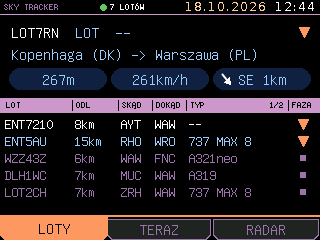
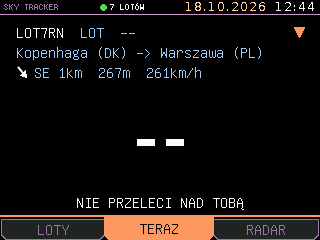
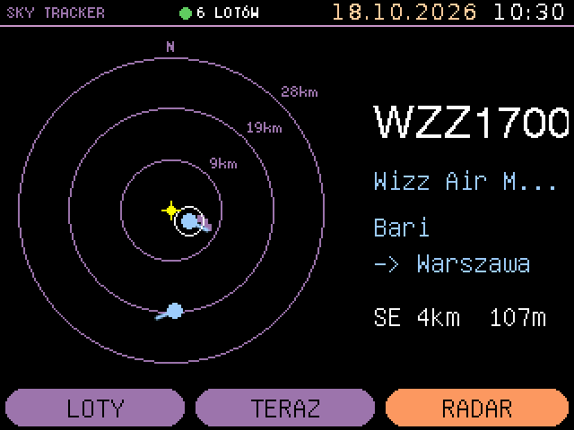
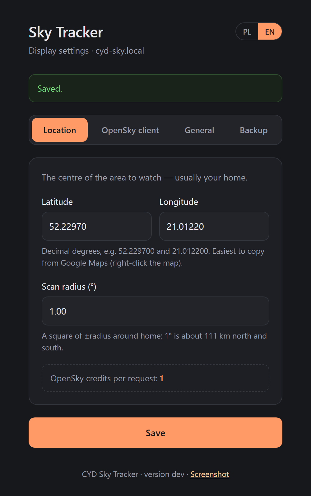
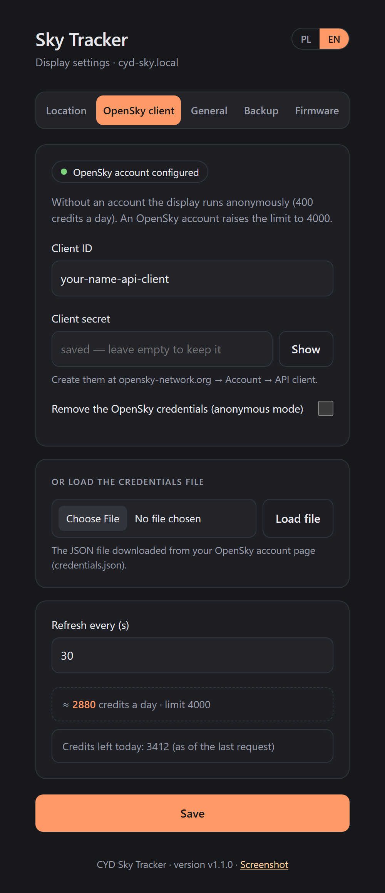
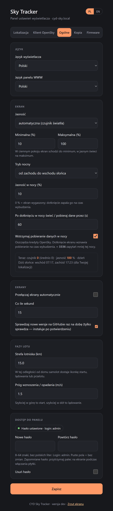
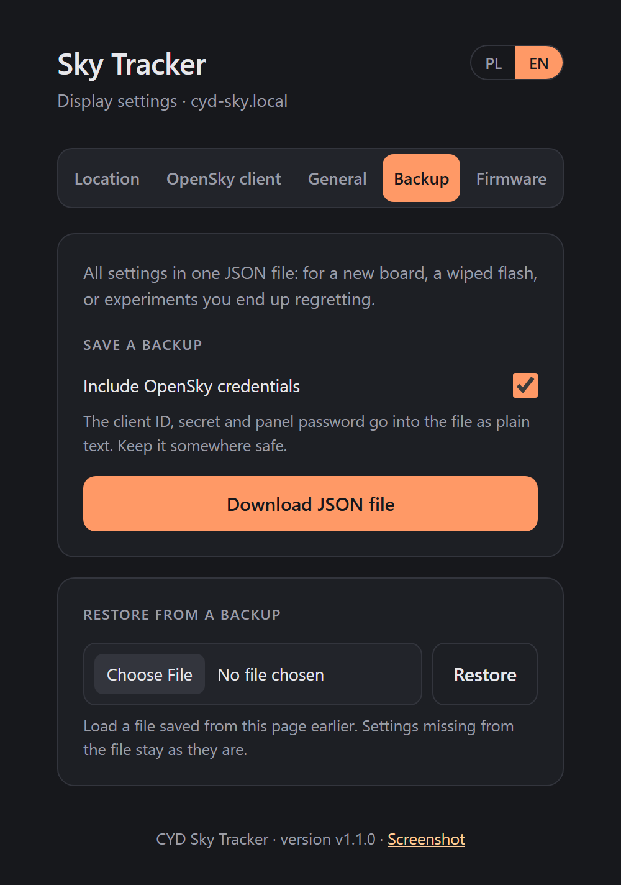

# CYD Sky Tracker 🛸

*"Space: the final frontier. Also, the airspace directly above the grill."*

I live near an airport in Warsaw, which means every barbecue with friends eventually hits the
same moment: someone tilts their head back, points a kielbasa-holding hand at the sky, and asks
*"co to za samolot?"* — what plane is that? Nobody knows. Someone opens Flightradar24 on their
phone, the grill smoke drifts into someone's eyes, and the argument about whose guess was
closest gets tabled indefinitely, honor unrestored.

This project exists to end that argument before it starts. A $15 ESP32 "Cheap Yellow Display"
sits by the grill and tells you, in real time: **which airline**, **which flight**, and
**which aircraft type** just went over your head — so bets about "I bet that's a 737" can
finally be settled with data instead of vibes, and everyone can get back to the kielbasa.

Powered by the [OpenSky Network](https://opensky-network.org/), dressed up like the bridge of a
starship that definitely does not belong to any copyright holder in particular.

No soldering. No radar dish. No red shirts were harmed in the making of this firmware.

> 🌐 **Project page & one-click install:** https://alasota.github.io/CYD-Flight-Tracker/ —
> plug the board in, open the page in Chrome or Edge, press *Install*. No PlatformIO required.

## Screenshots

Real captures straight off the device (via its `/screenshot.bmp` endpoint), Polish UI:

<table>
  <tr>
    <td align="center"></td>
    <td align="center"></td>
    <td align="center"></td>
  </tr>
  <tr>
    <td align="center"><b>LOTY / FLIGHTS</b><br>Nearest aircraft up top (flight, airline, type, route with cities, altitude, speed, direction), everything else in the table below.</td>
    <td align="center"><b>TERAZ / NOW</b><br>"When will it be over my head?" — a big countdown to the closest point of approach, or an honest "not passing overhead".</td>
    <td align="center"><b>RADAR</b><br>Your house in the middle, aircraft with heading ticks, range rings in km, and a summary of the nearest one.</td>
  </tr>
</table>

### Phase icons

What each aircraft is doing near the airport, as a tiny 16×12 px plane (shown here at 4×) in
the table's FAZA / PHASE column and next to the featured flight:

<table>
  <tr>
    <td align="center"></td>
    <td align="center"></td>
    <td align="center"></td>
    <td align="center"></td>
  </tr>
  <tr>
    <td align="center"><b>Takeoff</b><br>climbing, runway behind it</td>
    <td align="center"><b>Landing</b><br>descending, runway ahead</td>
    <td align="center"><b>Overflight</b><br>near the airport, level</td>
    <td align="center"><b>On the ground</b><br>taxiing or parked (top view)</td>
  </tr>
</table>

No icon at all means the aircraft is too far from the airport for a phase to mean anything.

## What is this thing

It polls live aircraft state vectors for a bounding box around your house (or your grill, same
thing), looks up the airline and aircraft type for anything worth arguing about, and shows it
all on a 2.8" TFT in a UI *inspired by* a certain 24th-century computer interface without being,
you know, *that* interface, because Paramount has lawyers and we have a hobby budget.

Built as a spiritual sibling of [micro-radar](https://github.com/AnthonySturdy/micro-radar) —
same idea (cheap board, live sky, OpenSky API), completely different outfit, and now an actual
answer to "what plane is that." Think of it as the away-team variant with better bragging rights.

## Features

- 📋 **Flights screen** — the closest aircraft featured up top (**flight, airline, aircraft
  type**, route with city names, altitude, speed, direction), plus a paged table of everything
  else in range: flight, distance, from/to (IATA), type and phase (takeoff / landing / overflight /
  on the ground — see [Phase icons](#phase-icons)).
  This is the bet-settling screen, front and center.
- ⏱️ **Now screen** — a big countdown to the moment the next aircraft is actually over your head.
- 🎯 **Radar screen** — a static radar plot with range rings, heading ticks and a nearest-aircraft
  summary.
- 🇵🇱/🇬🇧 **Polish or English UI** — on the display and, separately, on the config web page
  (a dark, tabbed panel: Location / OpenSky client / General / Backup / Firmware, with a live
  estimate of your daily OpenSky credit use).
- 📶 **Firmware updates over WiFi** — pick the new `.bin` on the settings page, no cable, settings
  kept. A bad build rolls itself back. The settings page can have a password.
- 🖖 **LCARS-inspired chrome** — black background, chunky color blocks, folder-tab navigation. An homage,
  not a photocopy. All shapes hand-drawn with LovyanGFX, zero ripped assets.
- 📡 Lives entirely on the ESP32 — no server, no phone app, no subscription, no away mission
  required.
- 🔐 Speaks OpenSky's current OAuth2 `client_credentials` auth (their old Basic Auth was
  decommissioned — this firmware didn't get that memo late).
- 🧭 Works anonymously too, just with a smaller communications budget (see Credits, below —
  the API kind, not the "roll them" kind).

## Hardware

- **ESP32-2432S028R** a.k.a. the "Cheap Yellow Display" (CYD) — ESP32-WROOM-32 + 2.8" 320x240
  ILI9341 TFT + resistive touch, all on one board, for about the price of a fancy coffee.
- A USB-C cable that actually carries data (you'd be amazed how many don't).
- That's it. No dilithium crystals required.

> ⚠️ CYD boards come in a few flavors. This project assumes the classic ILI9341 +
> resistive-touch "R" variant. If your colors are inverted or touch does nothing, you may have
> the ST7789/capacitive "C" variant — check before assuming the firmware is broken.

## Software you'll need

- [PlatformIO](https://platformio.org/) (CLI or the VS Code extension)
- A free account at [opensky-network.org](https://opensky-network.org/) if you want the good
  rate limits (4,000 credits/day instead of 400 — think of it as upgrading from a shuttlecraft
  to the actual ship)

## Getting it running

```bash
git clone <this-repo>
cd cyd-sky-tracker
pio test -e native      # test
pio run                 # build
pio run -t upload       # flash it, engage
pio device monitor -b 115200   # watch the logs scroll by dramatically
```

After the first USB flash, later builds can go over WiFi instead (see
[Updating the firmware](#updating-the-firmware-over-wifi)):

```bash
CYD_WEB_PASSWORD=your-panel-password pio run -e cyd-ota -t upload   # or --upload-port <board-ip>
```

### Connecting it to your WiFi

On first boot the board has no saved WiFi network, so it opens its own hotspot for setup:

| | |
|---|---|
| Hotspot name (SSID) | `CYD-Sky-Tracker-Setup` |
| Password | none (open network) |
| Setup page | http://192.168.4.1 |

1. On your phone or laptop, open the WiFi list and join **`CYD-Sky-Tracker-Setup`**. Your
   device may warn that the network has no internet. That's expected, so stay connected.
2. A sign-in page usually pops up on its own (the same kind hotels use). If it doesn't, open a
   browser and go to **http://192.168.4.1**.
3. Tap **Configure WiFi**, pick your home network from the list (or type its name), enter its
   password and tap **Save**.
4. The hotspot disappears and the board joins your network. Reconnect your phone to your
   normal WiFi. If the board can't connect (wrong password, say), the hotspot comes back and you
   can try again.

Good to know:
- The ESP32 only supports **2.4 GHz** WiFi. If your router broadcasts 5 GHz only, or uses the
  same name for both bands with 2.4 GHz turned off, the board won't see it.
- The board remembers the network across reboots and reconnects by itself if the router goes
  away for a while.
- If nobody connects to the hotspot within 3 minutes, it closes and reopens straight away, so
  you never have to reset the board to get it back.
- **Moving to another network:** power the board up somewhere its saved network isn't
  reachable and the setup hotspot appears again. To wipe the saved network outright, run
  `pio run -t erase` and flash again. That also erases every other setting (home location,
  OpenSky credentials and so on).

### Configuring it from the browser

Once it's on your network, open **http://cyd-sky.local** (or the board's IP address, which your
router's list of connected devices will show if `.local` names don't work on your system).
The settings page has five tabs; one **Save** button saves the first three at once:

1. **Location**: paste your home latitude and longitude (right-click a spot in Google Maps to
   copy them) and pick a scan radius. The page shows how many OpenSky credits one request costs
   at that radius. Bigger radius = more planes = more credits burned, so choose your engagement
   range wisely.
2. **OpenSky client**: optional. Paste your OpenSky `client_id` / `client_secret`, or upload
   the `credentials.json` file from your OpenSky account page. Set how often to refresh. The
   page estimates your daily credit use against the limit (400 anonymous, 4,000 with an
   account) and turns red if you'd run out. Once saved, the secret is never shown again: the
   field stays empty, and leaving it empty keeps the saved one. To go back to anonymous mode,
   tick *Remove the OpenSky credentials*.
3. **General**: display language, web panel language, automatic screen cycling, the
   flight-phase thresholds and the settings page's own password — see
   [Protecting the settings page](#protecting-the-settings-page-with-a-password) below.
4. **Backup**: save all settings to a JSON file or restore them from one — see
   [Backing up your settings](#backing-up-your-settings) below.
5. **Firmware**: install a new version over WiFi — see
   [Updating the firmware](#updating-the-firmware-over-wifi) below.

The **PL / EN** switch in the top-right corner changes the page's language. It doesn't affect
the display, which has its own setting on the General tab.

<table>
  <tr>
    <td align="center"></td>
    <td align="center"></td>
    <td align="center"></td>
    <td align="center"></td>
  </tr>
  <tr>
    <td align="center"><b>Location</b></td>
    <td align="center"><b>OpenSky client</b></td>
    <td align="center"><b>General</b></td>
    <td align="center"><b>Backup</b></td>
  </tr>
</table>

<sub>Screenshots show demo values (Warsaw city centre, a made-up API client).</sub>

### Backing up your settings

Flashing a fresh install with *Erase device*, swapping the board, or "just trying something"
wipes everything you set up. The **Backup** tab saves you the retyping:

- **Save a backup**: *Download JSON file* saves `cyd-sky-tracker-config.json` with all
  settings, grouped like the tabs (home location and radius; OpenSky client and refresh
  interval; languages, screen cycling and flight-phase thresholds), plus the firmware version
  it came from. *Include OpenSky credentials* is ticked by default — untick it to leave the
  `client_id` / `client_secret` and the settings page password out of the file (see the
  warning below).
- **Restore from a backup**: pick such a file and press *Restore*. The settings are applied and
  saved straight away, and the display picks them up (language, home location) without a
  reboot. Anything missing from the file stays as it is, so restoring a backup without
  credentials keeps the ones already on the board. Fields with invalid values are skipped and
  listed; files that aren't a Sky Tracker backup (e.g. OpenSky's `credentials.json`) are
  rejected and change nothing.

The WiFi network isn't part of the backup — the board keeps that separately, and you set it up
through the setup hotspot.

### Updating the firmware over WiFi

The first install needs the USB cable (or the *Install* button on the
[project page](https://alasota.github.io/CYD-Flight-Tracker/)). After that:

1. Download **`cyd-sky-tracker-<version>.bin`** from the
   [latest release](https://github.com/alasota/CYD-Flight-Tracker/releases/latest) — *not* the
   `…-full.bin` (that's the whole-flash image for cable installs; the page refuses it anyway).
2. Open the settings page → **Firmware** tab, pick the file, press **Update**. A progress bar
   shows on the page and on the display. Don't pull the plug for the ~20 seconds it takes.
3. The board restarts and the page reloads with the new version in the footer. Settings,
   OpenSky credentials and the remembered aircraft are all kept.

Safety nets:
- The board checks the file before switching to it: an ESP32 app image, fits the memory, and
  actually Sky Tracker firmware (each build carries a `CYDSKY-FW1|board=…|v=…` marker). Anything
  else is rejected and the running version stays.
- A cut connection or a power loss mid-upload leaves the old version running.
- **Automatic rollback:** a new version must run for 30 seconds and get the settings page up
  (or the WiFi setup hotspot) before it counts as good. If it crashes or restarts before that,
  the board boots the previous version again on its own.
- Going back to an older version works the same way (pick the older `.bin`). Versions released
  before OTA support existed don't carry the marker, so those need the cable / web installer.

From PlatformIO, `pio run -e cyd-ota -t upload` builds and sends the firmware to the same page
with `curl` (password from the `CYD_WEB_PASSWORD` environment variable, board address
`cyd-sky.local` or `--upload-port <ip>`).

### Protecting the settings page with a password

Out of the box the settings page has no password — the first setup has to work without one.
Anyone on your WiFi can then change the settings and install firmware, so the General and
Firmware tabs nag until you set one:

- **General → Panel access**: type a new password twice (8–64 characters, plain ASCII) and press
  **Save**. From then on the browser asks for it — login **`admin`** — on every page, the backup
  download, the screenshot and the firmware upload. Leave both fields empty to keep the current
  password; tick *Remove the password* to go back to none.
- The browser uses HTTP *Digest* login, so the password itself doesn't cross the network.
- Five wrong passwords in a row lock the page for 60 seconds.
- **Forgot it?** Hold a finger on the screen while you power the board up. After 5 seconds it
  asks *Remove the password?* — tap **YES**, and the page is open again (all other settings
  stay). Whoever can touch the board could reflash it anyway, so that's the trust boundary.

> [!WARNING]
> **The password keeps your housemates out, not a network eavesdropper.** The page is still
> plain HTTP: the password is protected by Digest, but the pages themselves, a backup you
> download and a firmware upload cross the network unencrypted, and an OpenSky secret you
> *type in* travels in clear text once. The secret and the password are stored unencrypted in
> the board's flash (NVS), so whoever gets hold of the board can dump them.
>
> - Run the board on a network you trust. No guest or shared networks, never exposed to the
>   internet.
> - Set a password, and use one you don't use anywhere else.
> - Create a separate OpenSky API client just for this board.
> - Treat a backup file with credentials like a password: it holds the `client_id`,
>   `client_secret` and the page password as plain text. Don't commit it to git or post it in
>   an issue or a chat; untick *Include OpenSky credentials* when you only need the rest.
> - If you think the secret leaked, revoke or regenerate it on your OpenSky account page.

## How it works, briefly

```
WiFi/config portal → opensky_client (OAuth2 + /states/all)
                            │
                            ▼
              aircraft_lookup (icao24 → airline + type, cached)
                            │
                            ▼
              table_view / radar_view (shared LCARS chrome)
```

Networking and rendering are kept firmly separated, so nobody has to relive the trauma of
untangling API calls from `tft.drawPixel()` at 2am.

## Roadmap

What might come next lives in **[ROADMAP.md](ROADMAP.md)**: no dates, no sprints, just ideas.
The same list shows up in the *What's next* section of the
[project page](https://alasota.github.io/CYD-Flight-Tracker/#roadmap), generated from that file
whenever the page is published.

## Credits & attribution

- Architecture inspiration: [micro-radar](https://github.com/AnthonySturdy/micro-radar) by
  Anthony Sturdy — go look at the original, it's a lovely little desk radar and does the
  circular-plot thing properly.
- Flight data: [The OpenSky Network](https://opensky-network.org/) — a community-run,
  volunteer-fed ADS-B network. If you like this project, consider running a receiver and
  feeding them data; it's how the whole thing stays free.
- Visual style: *inspired by* a famous sci-fi computer interface, built from scratch with
  original shapes and an open font. Not affiliated with, endorsed by, or officially sanctioned
  by any studio that owns the actual thing. We just think black backgrounds and orange
  rectangles are extremely funky.

## Disclaimer

This project tells you about airplanes. It does not control airplanes, talk to airplanes, or
grant you any authority over airspace whatsoever. If a real plane is doing something alarming,
this device's suggested course of action is the same as everyone else's: call the appropriate
authorities, not your ESP32.

## License

MIT. Live long, and go touch some grass while you wait for the next flight to enter your bbox.
